<div align="center">

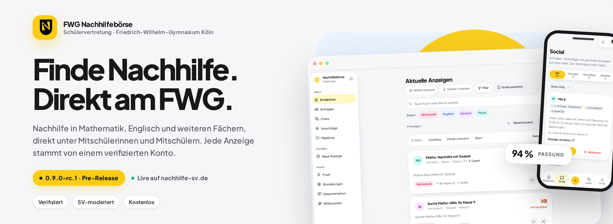

<h1>FWG Nachhilfebörse</h1>

<p><strong>Die schulinterne Nachhilfe-Plattform des Friedrich-Wilhelm-Gymnasiums Köln</strong></p>

<p>Nachhilfe suchen und anbieten, direkt unter Mitschüler:innen – ohne kommerzielle Plattform, moderiert von der SV.</p>

<p>
  <a href="https://nachhilfe-sv.de"></a>
  <a href="https://github.com/oskar26/nachhilfeb-rse/tags"></a>
  <a href="https://github.com/oskar26/nachhilfeb-rse"></a>
  <a href="https://github.com/oskar26/nachhilfeb-rse"></a>
  <a href="https://nachhilfe-sv.de/#/datenschutz"></a>
</p>

<p><strong>Aktuelle Version:</strong> <code>0.9.0-rc.1</code> · Pre-Release</p>

<p>Die Nachhilfebörse wird seit dem <strong>7. November 2025</strong> entwickelt.</p>

<p>Die finale Version ist noch nicht veröffentlicht – Feedback ist willkommen.</p>

</div>

---

## 📌 Die Idee

Die **FWG Nachhilfebörse** bringt Schüler:innen zusammen, die Nachhilfe suchen, und solche, die sie anbieten. Sie ist kein anonymer Marktplatz und keine kommerzielle Nachhilfe-Agentur: Alle Konten werden im SV-Raum verifiziert, die SV moderiert, und die Nutzung ist für alle am FWG kostenlos.

| Für Schüler:innen | Für Eltern | Für die SV |
|---|---|---|
| Anzeigen erstellen, passende Angebote finden, im Chat Termine ausmachen und nach dem ersten Kontakt bewerten. | Gemeinsam das Konto begleiten, den Eltern-Leitfaden lesen und die Einwilligung für unter 16-Jährige bestätigen. | Konten verifizieren, Meldungen bearbeiten, News veröffentlichen und die Plattform ohne externe Tracker beobachten. |

### Schnellzugriff

| | |
|---|---|
| 🌐 **Website** | [https://nachhilfe-sv.de](https://nachhilfe-sv.de) |
| 💻 **Quellcode** | [github.com/oskar26/nachhilfeb-rse](https://github.com/oskar26/nachhilfeb-rse) |
| 🏫 **Träger** | Schülervertretung (SV) des Friedrich-Wilhelm-Gymnasiums Köln |
| 📄 **Rechtliches** | [Impressum](https://nachhilfe-sv.de/#/impressum) · [Datenschutz](https://nachhilfe-sv.de/#/datenschutz) · [Transparenz](https://nachhilfe-sv.de/#/transparenz) |
| 🚦 **Status** | Pre-Release `0.9.0-rc.1` – noch kein finales Release |

---

## 🧭 Inhaltsverzeichnis

- [Die Idee](#-die-idee)
- [Screenshots](#-screenshots)
- [Funktionen](#-funktionen)
- [So funktioniert's](#-so-funktionierts)
- [Für Eltern](#-für-eltern)
- [Für die SV](#-für-die-sv)
- [Sicherheit & Datenschutz](#-sicherheit--datenschutz)
- [Technik](#-technik)
- [Projekt in Zahlen](#-projekt-in-zahlen)
- [Lokale Entwicklung](#-lokale-entwicklung)
- [Datenbank & SQL](#-datenbank--sql)
- [Projektstruktur](#-projektstruktur)
- [Transparenz](#-transparenz)
- [Mitmachen](#-mitmachen)
- [Lizenz & Rechte](#-lizenz--rechte)

---

## 📸 Screenshots

Echte Ansichten der laufenden App. Alle Personen, Anzeigen und Nachrichten sind fiktive Demo-Daten. Weitere Bilder liegen unter [`screenshots-app-website/`](screenshots-app-website/).

### Website & App

| Startseite | Feed & Suche | Anzeige im Detail |
|:---:|:---:|:---:|
| 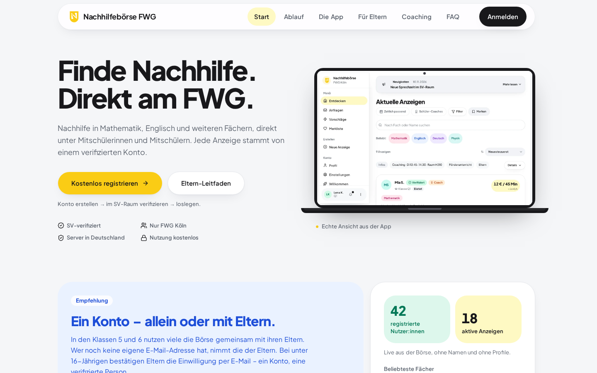 | 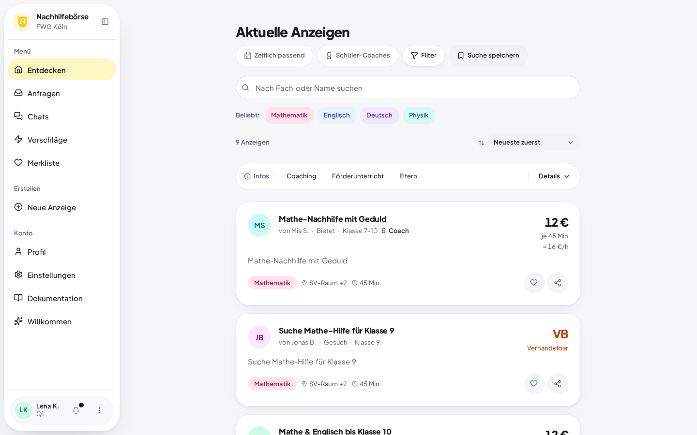 | 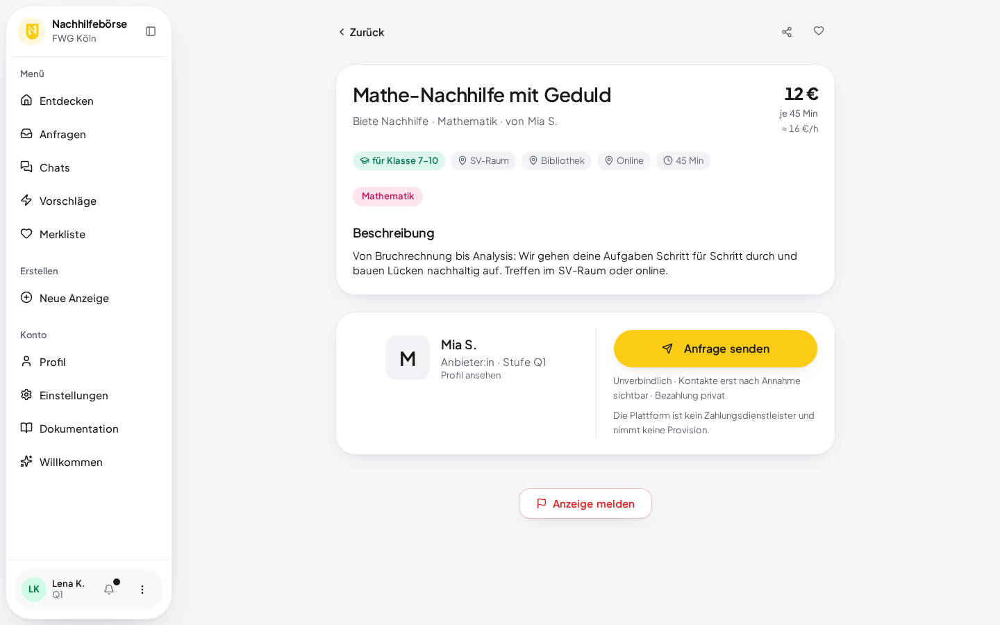 |
| **Startseite** | **Feed & Suche** | **Anzeige im Detail** |

| Anzeige erstellen | Social & Vorschläge | Chat & Termine |
|:---:|:---:|:---:|
| 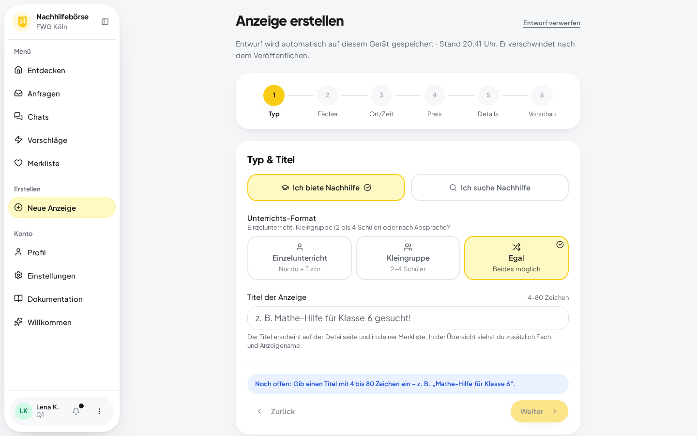 | 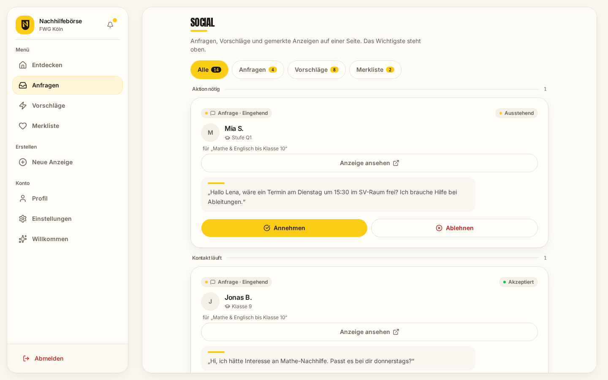 | 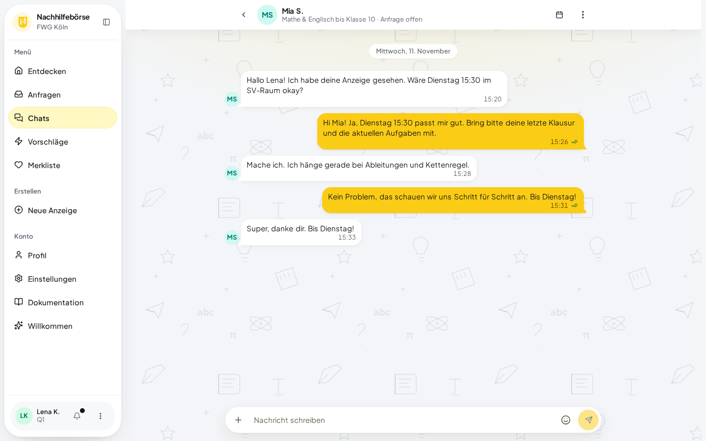 |
| **Anzeige erstellen** | **Social & Vorschläge** | **Chat & Termine** |

### Profil, Dark Mode & SV

| Profil | Dark Mode | SV-Panel |
|:---:|:---:|:---:|
| 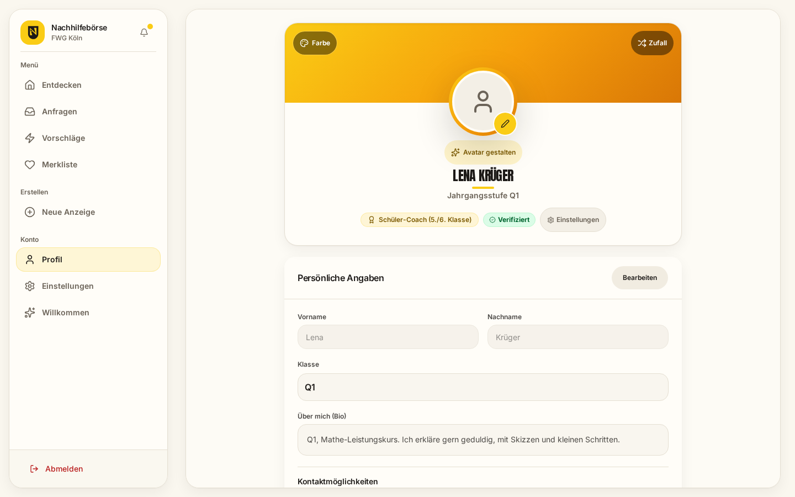 | 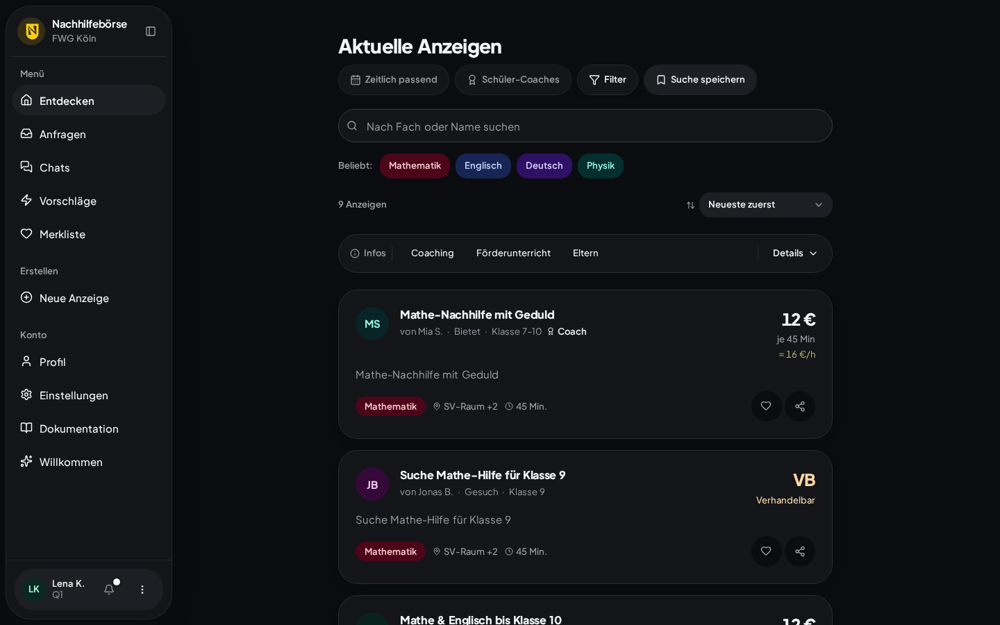 | 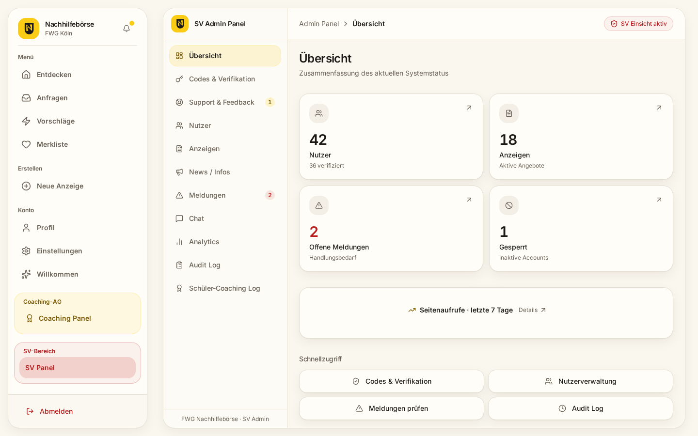 |
| **Profil** | **Dark Mode** | **SV-Panel** |

| Coaching-AG | Eltern-Leitfaden | Anmeldung |
|:---:|:---:|:---:|
| 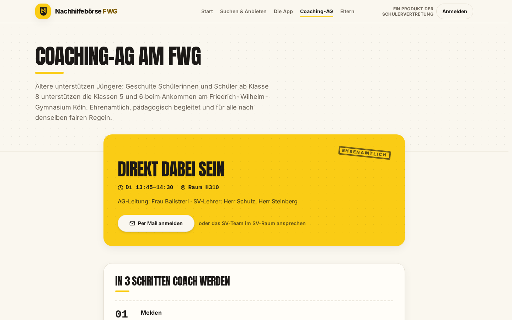 | 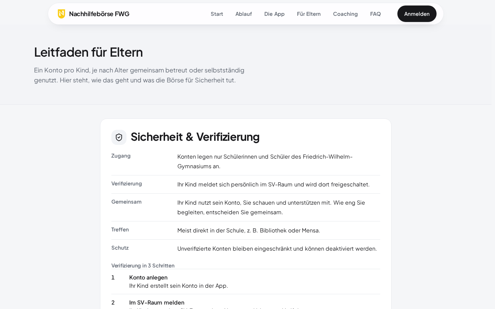 | 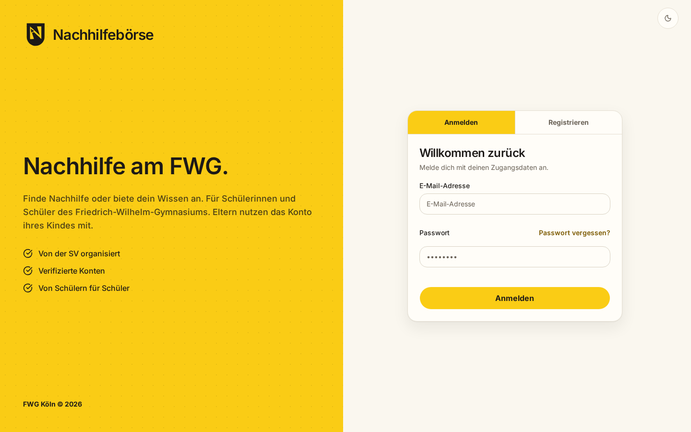 |
| **Coaching-AG** | **Eltern-Leitfaden** | **Anmeldung** |

### Mobil

| Feed | Anzeige | Social | Chat | Profil |
|:---:|:---:|:---:|:---:|:---:|
| 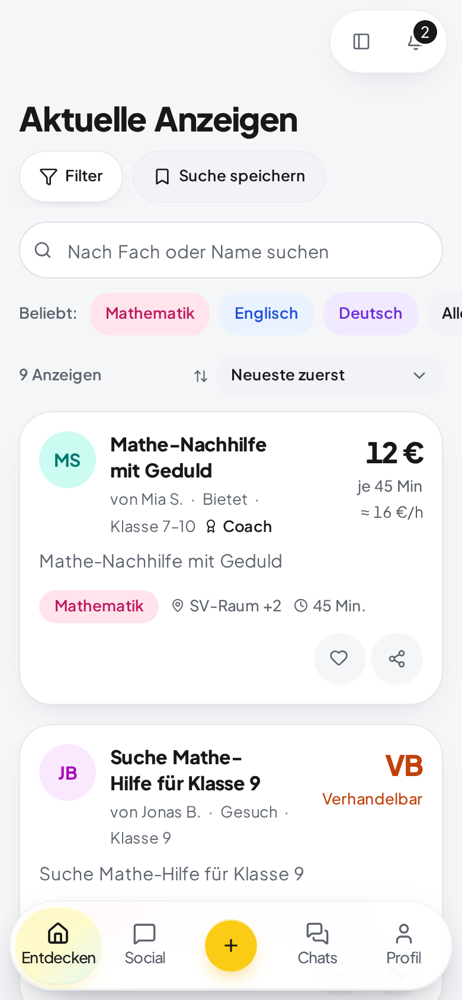 | 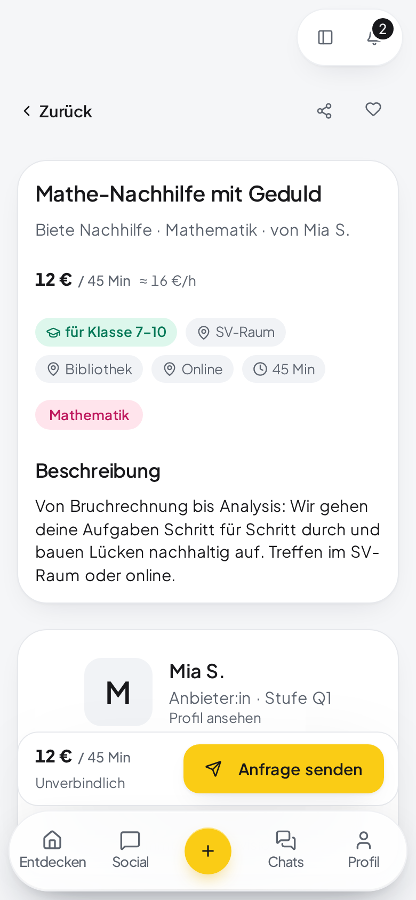 | 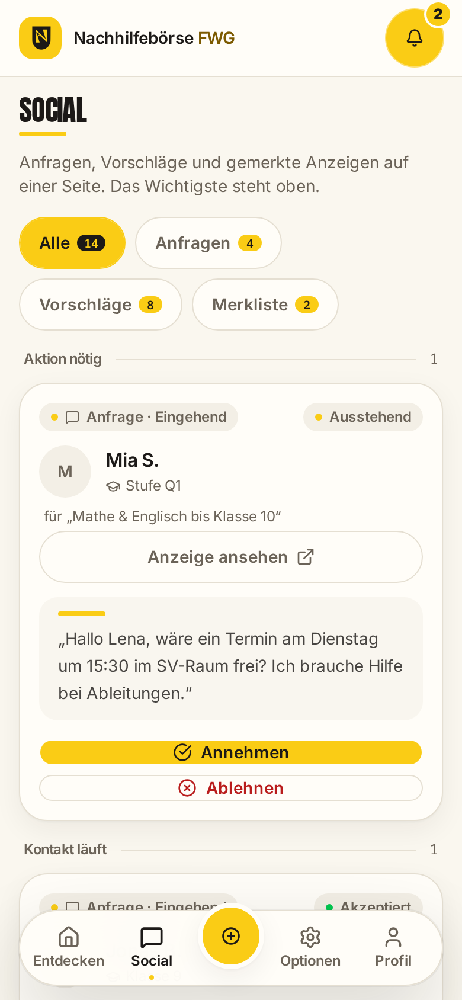 | 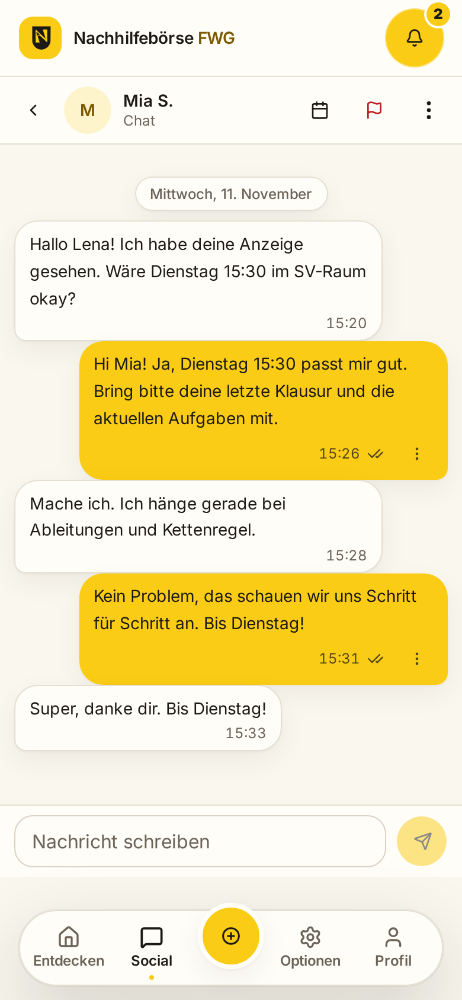 | 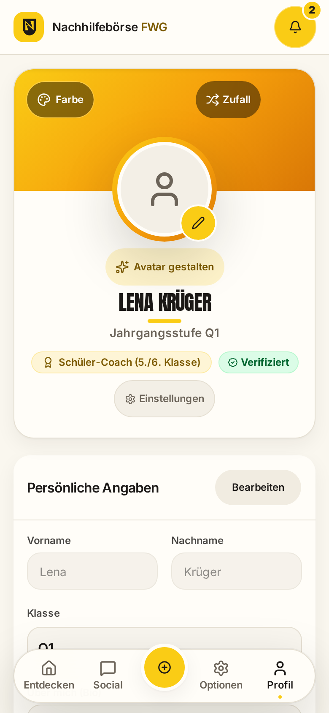 |

---

## ✨ Funktionen

<details open>
<summary><b>Für Schüler:innen</b></summary>

- **🔍 Smart Matching:** Fächer, Klassenstufe und gemeinsame Zeiten werden zu einem nachvollziehbaren Vorschlag kombiniert. Preis, Ort und Format stehen direkt daneben – und die Karte zeigt, **wie gut** etwas passt und **warum**.
- **📝 Anzeigen in Minuten:** Stepper für „biete“ und „suche“, mit Bildern, Zeitfenstern und automatisch gespeichertem Entwurf.
- **💬 Anfragen & Chat:** Kontakt aufnehmen, Termine vorschlagen, bestätigen und als Kalenderdatei (ICS) exportieren.
- **📥 Social:** Anfragen, Vorschläge und Merkliste in einer Übersicht – mit Typ-Filtern und direkter URL.
- **📌 Merkliste:** Anzeigen speichern und später vergleichen.
- **👤 Profile mit Bio:** Rich-Text-Bio, Fach-Tags, Verfügbarkeit und Verifizierungs-Hinweis.
- **⭐ Bewertungen:** nur nach einem echten Kontakt, keine Fake-Reviews.
- **🏅 Coaching-AG:** geschulte Schüler:innen ab Klasse 8 unterstützen die Klassen 5 und 6.

</details>

<details>
<summary><b>Für Eltern</b></summary>

- **👨‍👩‍👧 Gemeinsame Kontoführung:** Eltern können das Konto ihres Kindes mitbetreuen. Wenn das Kind noch keine eigene E-Mail-Adresse hat, kann das Konto mit der E-Mail-Adresse der Eltern geführt werden.
- **🛡️ Eltern-Leitfaden:** Was die Plattform kann, was sie nicht kann und wie Sicherheit funktioniert – [zum Leitfaden](https://nachhilfe-sv.de/#/eltern-leitfaden).
- **✅ Einwilligung unter 16:** Bei unter 16-Jährigen bestätigen Eltern die Einwilligung per E-Mail. Ohne Bestätigung bleibt das Konto gesperrt.
- **👀 Transparenz:** Keine Werbung, keine externen Tracker, Hosting in Deutschland.

</details>

<details>
<summary><b>Für die SV (Administration)</b></summary>

- **✅ Verifikation:** Persönlich im SV-Raum, per Einladungs- oder Verifizierungscode.
- **📣 Moderation:** Meldungen bearbeiten, Nutzer verwalten, Inhalte prüfen.
- **📰 News:** Mitteilungen für die Plattform veröffentlichen und verwalten.
- **📊 Analytics:** Live-Statistiken zu Anzeigen, Nutzern und Seitenaufrufen – ohne externe Tracker.
- **🧾 Audit-Log:** nachvollziehbare Einträge zu administrativen Aktionen.

</details>

<details>
<summary><b>Technisch</b></summary>

- **📱 PWA:** installierbar auf Handy und Desktop, Bottom-Nav mobil, Sidebar auf Desktop.
- **🌗 Dark & Light Mode:** durchgängiges Farbsystem mit Gelb als Markenfarbe.
- **🔔 News & Push:** Hinweise in der App und optionale Push-Benachrichtigungen.
- **💾 Autosave:** Anzeigen-Entwürfe bleiben lokal erhalten – mit Bestätigung vor dem Verwerfen.
- **📚 Dokumentation:** eigene Docs-Site mit Suche, Inhaltsverzeichnis und LLM-Ausgabe.

</details>

---

## 🚀 So funktioniert's

1. **Registrieren:** Mit Name, Klasse und Geburtsdatum ein Konto anlegen. Unter 16 Jahren bestätigen die Eltern die Einwilligung per E-Mail.
2. **Verifizieren:** Im SV-Raum vorbeikommen. Das SV-Team prüft die Zugehörigkeit zum FWG und schaltet das Konto frei.
3. **Suchen oder anbieten:** Eine Anzeige erstellen oder direkt im Feed stöbern – mit Filtern für Fach, Klasse, Preis, Ort und Zeit.
4. **Kontakt aufnehmen:** Im Chat Fragen klären, einen Termin vorschlagen und nach dem ersten Treffen eine Bewertung abgeben.

> Die Nachhilfe selbst findet außerhalb der App statt. Preise werden privat vereinbart; ein Richtwert sind etwa 12 € pro Stunde.

---

## 👨‍👩‍👧 Für Eltern

Die Börse ist für die **gemeinsame Nutzung** gedacht. In den Klassen 5 bis 7 empfehlen wir, das Konto gemeinsam zu betreuen. Ältere Schüler:innen können die Börse selbstständig nutzen – die Verantwortung für Inhalte, Sicherheit und Datenschutz bleibt beim SV-Team.

**Was die Börse nicht ist:**

- keine Nachhilfe-Agentur und keine Vermittlungsgebühr,
- keine Zahlungsabwicklung,
- kein anonymer Marktplatz,
- kein Ort für Werbung oder Tracking.

Der vollständige [Eltern-Leitfaden](https://nachhilfe-sv.de/#/eltern-leitfaden) erklärt Verifizierung, Preise, Kontaktwege und die Rechte von Kindern und Eltern.

---

## 🛡️ Sicherheit & Datenschutz

- **Verifizierung statt Anonymität:** Die Plattform ist auf verifizierte Konten ausgelegt. Die Verifizierung findet im SV-Raum statt; danach stehen Anzeigen, Kontakt und Chat offen.
- **Serverseitiger Inhaltsfilter:** Schutz vor beleidigenden oder unangemessenen Inhalten auf Datenbankebene.
- **Kein Tracking-Müll:** keine externen Analyse- oder Werbedienste, kein Profiling für Werbung.
- **Hosting in Deutschland:** PHP-API und MySQL bei ALL-INKL.
- **Keine IP-Adressen in der App-Datenbank:** IP-Adressen werden nur für das Rate-Limiting verarbeitet.
- **Pseudonyme Statistik:** Die Nutzungsstatistik ist bei angemeldeten Konten pseudonym; IP-Adressen und Gerätekennungen werden nicht gespeichert.
- **Blockieren & melden:** Nutzer:innen können Kontakte blockieren und Inhalte an die SV melden.

Details: [Datenschutzerklärung](https://nachhilfe-sv.de/#/datenschutz) · [Cookies](https://nachhilfe-sv.de/#/cookies) · [Transparenz](https://nachhilfe-sv.de/#/transparenz)

---

## 🛠️ Technik

| Ebene | Technologien |
|---|---|
| **Frontend** | React 19, TypeScript, Vite, Tailwind CSS 4, Motion, Lucide Icons, Tiptap |
| **Backend & DB** | PHP 8, MySQL/MariaDB, ALL-INKL |
| **PWA** | vite-plugin-pwa, Workbox |
| **Docs** | Fumadocs, Vite |
| **Tests** | Vitest, 20 Testdateien / 206 Tests |
| **Deployment** | ALL-INKL Webhosting, GitHub |

---

## 📊 Projekt in Zahlen

| Kennzahl | Wert | Kennzahl | Wert |
|:---:|:---:|:---:|:---:|
| Zeilen TypeScript/TSX | **~41.300** | TS/TSX-Dateien | **158** |
| UI-Komponenten | **39** | PHP-Module | **31** |
| SQL-Migrationen | **16** | automatisierte Tests | **206** |
| Entwicklung seit | **7. November 2025** | Zeitraum | **12+ Monate** |
| Quellcode | **öffentlich** | Status | **Pre-Release** |

> Stand: 17. November 2026. Die Zahlen werden aus dem aktuellen Repository ermittelt und können sich mit jedem Commit ändern.

---

## 💻 Lokale Entwicklung

```bash
# Abhängigkeiten installieren
npm install

# Frontend mit Vite starten
npm run dev

# Tests ausführen
npm test

# Produktionsbuild inklusive Docs-Site
npm run build
```

Die Anwendung läuft lokal unter `http://localhost:5173`. Für die PHP-API wird eine MySQL-Datenbank benötigt; die Migrationen liegen unter [`sql-updates/`](sql-updates/) und werden über phpMyAdmin bei ALL-INKL eingespielt.

### Demo-Vorschau ohne Login

Für Präsentationen und UI-Arbeit gibt es eine lokale Demo mit fiktiven Daten:

```bash
npm i --no-save playwright
npx vite --config vite.demo.config.ts
```

Die Demo läuft unter `http://localhost:5182` und ersetzt alle API-Aufrufe durch lokale Mock-Daten. Sie ist ausschließlich für die Entwicklung gedacht.

---

## 🗄️ Datenbank & SQL

Die aktuellen Migrationen und die Import-Reihenfolge stehen in [`sql-updates/README.md`](sql-updates/README.md).

- **Neu in 0.9.0-rc.1:** [`016_privacy_chat_consent_blocks.sql`](sql-updates/016_privacy_chat_consent_blocks.sql) – unter anderem Anzeigen-Titel, Avatar-URL, Lesestatus, Report-Details, Analytics-Opt-out sowie die Tabellen `user_blocks` und `parental_consents`.
- **Komplett-Upload:** [`upload_0.9.0-rc.1.sql`](sql-updates/upload_0.9.0-rc.1.sql) – alle Migrationen 001–016 in der richtigen Reihenfolge, idempotent und ohne `CREATE DATABASE`/`DROP DATABASE`.
- **Bereits aktuell?** Wenn die Datenbank schon 001–015 enthält, reicht `016_privacy_chat_consent_blocks.sql`.

---

## 📁 Projektstruktur

```text
nachhilfev2/
├── src/
│   ├── pages/          # Feed, Chat, Profile, Eltern, SV-Panel, Rechtliches …
│   ├── components/     # UI, Layout, Modals, Social-Karten
│   ├── context/        # Auth, Theme
│   └── lib/            # API-Client, Matching, Analytics, Helpers
├── api/                # PHP-API (ALL-INKL)
├── sql-updates/        # Schema, Migrationen, Upload-Datei
├── test/               # Vitest-Tests
├── docs-site/          # Fumadocs-Dokumentation
├── docs/               # Briefings, Screenshots, README-Banner
├── scripts/            # Build-, Screenshot- und Demo-Skripte
└── screenshots-app-website/  # Aktuelle Website- und App-Screenshots
```

---

## 🤖 Transparenz

Dieses Projekt ist **Open Source** und erklärt seine Entstehung offen – auch auf der Website: [Transparenzhinweis](https://nachhilfe-sv.de/#/transparenz).

- Seit dem **7. November 2025** entsteht die Nachhilfebörse im Wesentlichen durch **agentisches Coding**: KI-Agenten schreiben und iterieren den Code, ein Mensch setzt Ziele, prüft, entscheidet und dirigiert.
- Der Aufwand beläuft sich auf **mehrere hundert Stunden**. Oft laufen dafür lange Workflows über viele Tage und Wochen.
- Ein **großer Teil des Codes und der Texte wurde mit KI erstellt**. Das ist Absicht und wird hier nicht beschönigt: Die Plattform ist ein Schülerprojekt, das mit modernen Werkzeugen gebaut wird, nicht das Ergebnis eines klassischen Entwicklerteams.
- **Verantwortung bleibt menschlich:** Inhalte, Sicherheitskonzept, Datenschutz und Entscheidungen über Features prüft und trägt das SV-Team. Fehler und Lücken können trotzdem vorkommen. Feedback an [technik@nachhilfe-sv.de](mailto:technik@nachhilfe-sv.de) oder als [Issue auf GitHub](https://github.com/oskar26/nachhilfeb-rse/issues).

> Weniger Maschine. Mehr Haltung: Wir sagen, woher der Code kommt, damit ihr einschätzen könnt, was ihr benutzt.

---

## 🤝 Mitmachen

1. Fork erzeugen und Branch anlegen.
2. Änderung mit klarer Commit-Nachricht.
3. Pull Request öffnen und kurz beschreiben, was sich warum ändert.

Fehler, Ideen und Sicherheitshinweise: [github.com/oskar26/nachhilfeb-rse/issues](https://github.com/oskar26/nachhilfeb-rse/issues) oder [technik@nachhilfe-sv.de](mailto:technik@nachhilfe-sv.de).

---

## 📄 Lizenz & Rechte

Entwickelt für das **Friedrich-Wilhelm-Gymnasium Köln**, betrieben durch die **Schülervertretung**. Der Quellcode ist öffentlich; die Plattform selbst ist ein **nicht-kommerzielles Schülerprojekt**.

Rechtliches: [Impressum](https://nachhilfe-sv.de/#/impressum) · [Nutzungsbedingungen](https://nachhilfe-sv.de/#/nutzungsbedingungen)

---

<div align="center">

<p><strong><a href="https://nachhilfe-sv.de">nachhilfe-sv.de</a></strong> · von Schülern, für Schüler, mit offenen Augen.</p>

</div>
